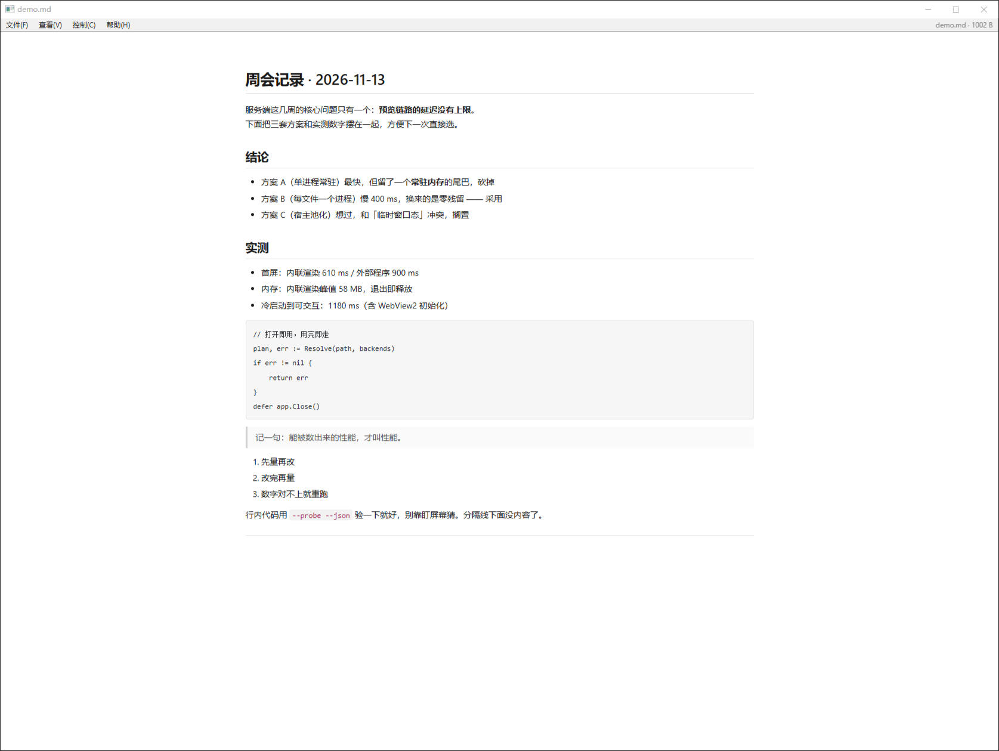

# previewer

[](https://github.com/c-dyang/previewer/actions/workflows/ci.yml)

Windows 上的单窗口快速查看器。一次调用一个窗口，看完即关 —— 不常驻、不驻留托盘、不起后台服务、不写注册表。

外壳照 Adobe Flash Player 独立播放器那套：**原生标题栏（= 文件名）+ 22px 细菜单条 + 铺满画布**。
没有工具栏、没有侧栏、没有标签页。



## 为什么又造一个

日常要看的文件是散的：日志、md 文档、截图、一段 mp4、一份 PDF。系统自带的查看器一样只管一种，
编辑器打开重（还锁文件），播放器只为视频设计。真正想要的行为只有一个：**双击 → 看到 → 关掉，进程消失**。

所以这里的设计约束是硬的：

- **状态住在文件里，不住在进程里。** 没有主窗口、没有"上次打开"，窗口是临时态。
- **一次一个进程。** 开得糙一点（~600 ms），但不留下任何常驻物，任务管理器里查不到它。
- **能看不了的，明确说出来。** 每一次降级都带一个可枚举的原因，不静默失败。

## 它能看什么

| 内容 | 谁来画 | 备注 |
|---|---|---|
| `.md` `.markdown` | 本进程解析 | 标题 / 围栏 / 列表 / 引用 / 分隔线 / 行内；YAML frontmatter 丢掉 |
| `.txt .log .json .py .go …` 及无后缀 | 本进程渲染 | BOM → UTF-8 校验 → **GBK 兜底**（中文系统日志不乱码） |
| `.png .jpg .gif .webp .bmp .ico .svg .avif` | Chromium `` | 透明底画棋盘格 |
| `.pdf` | WebView2 内置 PDF viewer | 菜单条仍在，Esc 能关 |
| `.html .htm` | Chromium 直通 | 用文件自己的 origin，不带外壳 |
| `.mp4 .m4v .mov .webm .ogv`（H.264/VP9/AV1） | Chromium `<video>` | |
| `.mp3 .m4a .aac .wav .flac .ogg .opus` | Chromium `<audio>` | |
| `.mkv .avi .ts .flv .rmvb .wmv`、HEVC、`.tif .heic .psd`、`.ape .wma` | 外部播放器 | mpv / VLC / PotPlayer / ffplay，找到哪个用哪个 |
| 认不出的二进制 | 十六进制头 4 KB | 告诉你"这是二进制" |

## 构建

需要 Windows 10/11 x64、Go 1.27+、WebView2 Runtime（Win11 自带；LTSC / 精简系统装 Evergreen Runtime 即可）。

```
go build -o preview.exe .
go test ./...
```

零 cgo。依赖：`github.com/jchv/go-webview2`（纯 Go 绑 WebView2，MIT，内嵌 `WebView2Loader.dll` 所以 exe 是单文件）、
`golang.org/x/sys`、`golang.org/x/text`（GBK 解码）。

也可以 `go install github.com/c-dyang/previewer@latest`，装出来的二进制叫 `previewer.exe`。

## 用法

**选项必须写在文件路径之前** —— Go 的 `flag` 遇到第一个非选项参数就停止解析，
`preview.exe <文件> --debug` 里的 `--debug` 会被当成第二个文件路径丢掉。

```
preview.exe                                # 裸开：空壳窗口，等文件拖进来
preview.exe <文件>
preview.exe --probe --json [文件]           # 只探测能力与路由，不开窗口、无副作用
preview.exe --external <文件>               # 强制交外部程序
preview.exe --fullscreen <文件>
preview.exe --debug <文件>                  # 开 DevTools 与右键菜单
preview.exe --width 1400 --height 900 <文件>
preview.exe --auto-close 8 <文件>           # 8 秒后自动关窗（脚本化冒烟用）
preview.exe --drop-sim <文件>               # 冒烟钩子：当成「拖进画面」处理
preview.exe --version
```

退出码：`0` 正常 · `2` 用法错 · `3` 缺 WebView2 Runtime · `4` 目标打不开 · `6` 起窗口失败 · `7` 无可用外部播放器 · `8` 无交互桌面。

## 拖拽：两条通路，最后都能拿到路径

裸开的窗口（或任何已开窗口）都能接文件拖拽，两条通路走的是不同层的 API，但**都能拿到绝对路径**：

| 拖到 | 通路 | 拿到什么 | 结果 |
|---|---|---|---|
| **标题栏 / 窗口边框**（非客户区） | Win32 `WM_DROPFILES`（`DragAcceptFiles` + 子类化 WndProc） | 完整路径 | 走完整路由，重载页面 |
| **画面里**（客户区） | HTML5 `drop` → `chrome.webview.postMessageWithAdditionalObjects` → 宿主 `ICoreWebView2File.GetPath()` | 完整路径 + 内容 | 就地换内容，路径相关菜单同样可用 |

画面那条为什么不能只靠 JS：浏览器给页面的 `dataTransfer` 只有这些，`File.path` 恒为空（那是 Electron 的私有扩展）：

```json
{"types":["Files"],"data":{"Files":""},
 "files":[{"name":"gbk-log.txt","type":"text/plain","size":65,"path":""}]}
```

但 WebView2 在**宿主侧**留了官方出口（[WebView2Feedback#501](https://github.com/MicrosoftEdge/WebView2Feedback/issues/501) → [WebMessageObjects](https://github.com/MicrosoftEdge/WebView2Feedback/blob/main/specs/WebMessageObjects.md)）：
页面把 DOM `File` 原样回传，宿主拿到的是 [`ICoreWebView2File`](https://learn.microsoft.com/en-us/microsoft-edge/webview2/reference/win32/icorewebview2file)，`get_Path` 就是绝对路径。

```js
// 页面侧（drop 里一行）
chrome.webview.postMessageWithAdditionalObjects("pv-drop", files);
```

本程序的实现见 [`hostdrop.go`](hostdrop.go)：`go-webview2` 门面没声明这几个接口，所以按 COM 槽位直接调
（`AddWebMessageReceived` = 34，`GetAdditionalObjects` = 6，`GetPath` = 3）。

**降级两道保险**：

1. 运行时没有 args2（WebView2 < 1.0.1774.30，即 Edge 111 之前）→ 开窗时注册失败（`drop.log` 会写原因），页面**不**走这条通路。
2. 走了但宿主 700 ms 内没接住 → 页面自己兜底渲染（`readAsArrayBuffer` + base64 交给 Go 解码，或 `blob:` URL）。
   这条兜底渲染即 `degraded_reason = drop_without_path` 仍会出现的唯一场景，路径相关菜单此时置灰。

`blob:` URL 只活在当前文档里，所以兜底那条链**不能靠重载页面**实现 —— 只能在当前页面里换内容：
Go 造 HTML → 注入 → 页面回执 `replace-done`。

## 路由：`f(类型, 容器, 编码, 可用后端)`

路由是**两维**的：`Kind` 说"这是什么"，`Renderer` 说"谁来画"
（`shell` 本进程 HTML / `direct` 直通 Chromium / `media` Chromium 解码器 / `external` 外部播放器）。

降级 = `Renderer` 的迁移，每次迁移都带一个 `degraded_reason`：

`container_unsupported_by_chromium` · `codec_unsupported_by_chromium` · `codec_unverified` ·
`image_format_unsupported_by_chromium` · `text_truncated_at_limit` · `no_external_player_found` ·
`empty_file` · `binary_unidentified` · `drop_without_path`

### 三条降级链互不替代

- **md 降级 = 换渲染器**（本进程 parser → 纯文本 `<pre>`）
- **图片降级 = 换解码器**（Chromium 内置 → 本机外部解码器）
- **视频降级 = 换播放引擎或交出去**（Chromium 内置 → 外部播放器）

编码探测：mp4/mov 在**头 1 MiB + 尾 1 MiB** 里找 `avc1/avc3/hvc1/hev1/av01/vp09/mp4v/dvhe/dvh1`；
mkv 在头 1 MiB 里找 `V_MPEG4/ISO/AVC`、`V_MPEGH/ISO/HEVC`、`V_AV1`、`V_VP9`。
头尾都扫是因为非 faststart 的文件 moov 在尾部。

## 快捷键

| 键 | 动作 |
|---|---|
| `Esc` | 关窗口（菜单开着时先收菜单） |
| `F11` / `f` | 无边框全屏 / 还原 |
| `Space` | 播放 / 暂停 |
| `← / →` | 后退 / 前进 5 秒 |
| `↑ / ↓` | 音量 ±5% |
| `M` | 静音 |
| `Ctrl+O` | 打开…（本窗口内换文件） |
| `Ctrl+E` | 在资源管理器中显示 |
| `Ctrl+Enter` | 用默认程序打开 |
| `Ctrl+= / - / 0` | 放大 / 缩小 / 实际大小 |
| `Alt+F / V / C / H` | 打开对应菜单 |

菜单条右侧常显 `文件名 · 大小`，降级时追加降级原因（橙色）。

## `--probe --json`：给 agent / 脚本的契约

单条 JSON 信封走 stdout，日志走 stderr，退出码有意义，`--probe` 无副作用、不开窗口。

```json
{
  "ok": true,
  "schema_version": 1,
  "target": {
    "path": "D:\\clips\\demo.mp4",
    "name": "demo.mp4",
    "size": 56617102,
    "ext": ".mp4",
    "kind": "video",
    "renderer": "external",
    "container": "mp4",
    "codec": "hvc1",
    "backend": "C:\\Tools\\mpv\\mpv.exe",
    "degraded_reason": "codec_unsupported_by_chromium",
    "notes": ["编码 HEVC(hvc1) Chromium 解不了，换播放引擎：交 mpv"]
  },
  "backends": {
    "webview2": {
      "present": true,
      "version": "157.0.4341.46",
      "runtime_dir": "C:\\Program Files (x86)\\Microsoft\\EdgeWebView\\Application\\157.0.4341.46",
      "source": "HKLM/WOW6432Node",
      "media_support": { "h264": true, "vp9": true, "av1": true, "hevc": false, "mkv": false }
    },
    "external_players": [
      { "name": "mpv", "path": "C:\\Tools\\mpv\\mpv.exe", "video": true, "audio": true, "image": true }
    ],
    "os": "windows",
    "arch": "amd64"
  }
}
```

`--probe` 不需要交互式桌面，可以在服务会话 / CI / SSH 里跑，所以**能力探测与路由验证不需要 GUI**。

## 设计取舍

细节与踩坑在 [`docs/design-notes.md`](docs/design-notes.md)，这里只留三条最影响架构的：

- **二进制是 CUI 子系统（`Subsystem=3`），不是 `-H windowsgui`。** 后者会让 `os.Stdout` 失效，
  `--probe --json` 这条给 agent 的契约就废了。双击时的黑框靠 `GetConsoleProcessList`
  判「控制台上只挂着自己」才藏 —— 从 shell 里跑时绝不藏，否则会把用户的终端一起藏掉。
- **不开 DPI 感知。** 开了之后 WebView2 视口按物理像素给、却按系统缩放栅格化，整页放大且右侧被裁。
- **`Eval` 一律经 `Dispatch` 回 UI 线程。** `CoreWebView2` 是单元线程对象，从别的 goroutine 直接调
  会返回 `RPC_E_WRONG_THREAD`，而绑定的库不看返回值 ⇒ 静默无效。

## 已知限制

1. **文本上限 4 MiB**，超出截断并报 `text_truncated_at_limit`。大文件虚拟滚动（mmap + 行索引）在 TODO 里。
2. **md 不认表格和脚注**，按段落原样输出。
3. **`.html` 走直通**，没有本程序的菜单条（靠注入的全局 JS 兜住 `Esc` / `F11`）。
4. **HEVC 按未安装处理。** 装了系统 HEVC Video Extensions 的机器上 Chromium 其实能解 HEVC，
   此时会被保守地判成降级 —— 这是"宁可交出去也别在黑框里报错"的取舍。
5. **画面拖拽依赖 WebView2 运行时 ≥ 1.0.1774.30**（`WebMessageReceivedEventArgs2`）。更老的运行时上会自动退回
   「只有名字和内容」的就地渲染（`drop_without_path`），功能不中断、但路径相关菜单置灰。
6. **可用的外部播放器决定体验下限。** 只有 ffplay 时降级会掉进 SDL 窗口；装 mpv 后自动优先用它，代码不用改。
7. **`Ctrl+O` 的文件对话框借 PowerShell WinForms**，起窗约 1 s（TODO 里有 `IFileOpenDialog` 方案）。
8. **`--server` 复用实例没做。** 现在每次调用约 600 ms，与"临时窗口态"的信条一致。

## 版本

`0.3.0` —— 画面拖拽经 `ICoreWebView2File` 拿绝对路径（两条拖拽通路能力对齐）、7 类内容路由 + 三条降级链、`--probe --json` 契约、无控制台黑框。
上一版 `0.2.0`：画面拖拽只有文件名与内容（`drop_without_path`）。
路线图与未排期项见 [`TODO.md`](TODO.md)。

## 许可

MIT，见 [LICENSE](LICENSE)。


